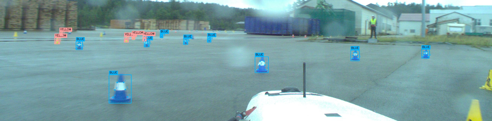
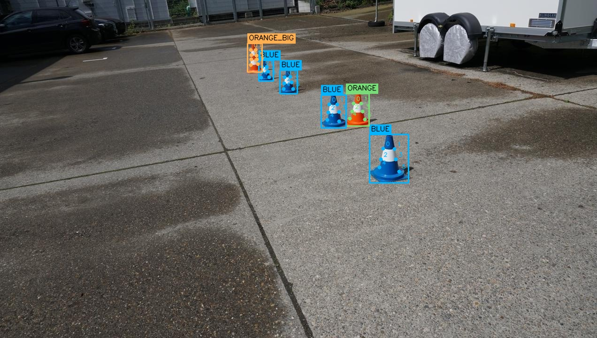
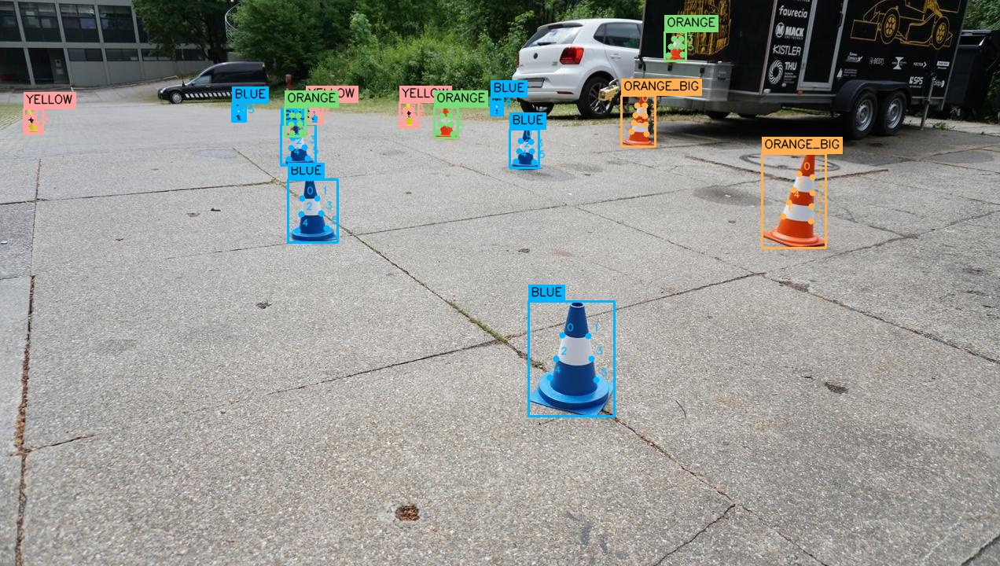
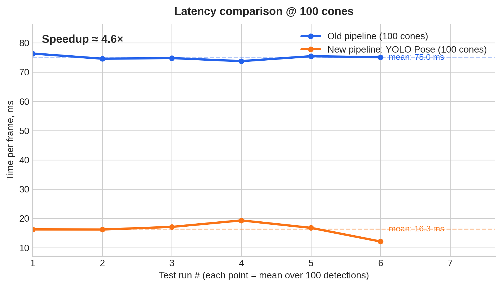

# BRT Cone Pose Dataset

Cone dataset for Formula Student Driverless in YOLO-Pose format. Each cone has a bounding box, a class and 8 keypoints. Images are taken from [FSOCO](https://fsoco.github.io/fsoco-dataset/).

The dataset is reverse engineered, so some labels may be inaccurate. Perfect annotation is not guaranteed.

[Download](https://drive.google.com/file/d/1auin-vVcP3dQMW-wuloVYWxoqvQshGWk/view?usp=share_link)





## Format

11523 images: 9218 train, 1152 val, 1153 test.

```text
fsoco-pose-split
├── data.yaml
├── images
│   ├── train
│   ├── val
│   └── test
└── labels
    ├── train
    ├── val
    └── test
```

Classes: `0 BLUE`, `1 ORANGE_BIG`, `2 ORANGE`, `3 UNDEFINED`, `4 YELLOW`.

One line per cone, all values normalized to [0, 1]:

```text
<class> <x> <y> <w> <h> <k0_x> <k0_y> <k0_v> ... <k7_x> <k7_y> <k7_v>
```

## Training

```python
from ultralytics import YOLO

model = YOLO("yolo26n-pose.pt")
results = model.train(
  data="fsoco-pose-split/data.yaml",
  epochs=100,
  batch=32,
  device=0,
)
```

## Speed

Compared to a multi-stage pipeline (detector, then keypoint model), a one-stage pose model gives about 5x lower end-to-end latency.

TensorRT, RTX A2000, yolo26n-pose, imgsz 800, up to 100 cones per frame.



<sub>Annotations by [Bauman Racing Team](https://baumanracing.ru), CC BY 4.0. Images come from FSOCO and are covered by the FSOCO license.</sub>
